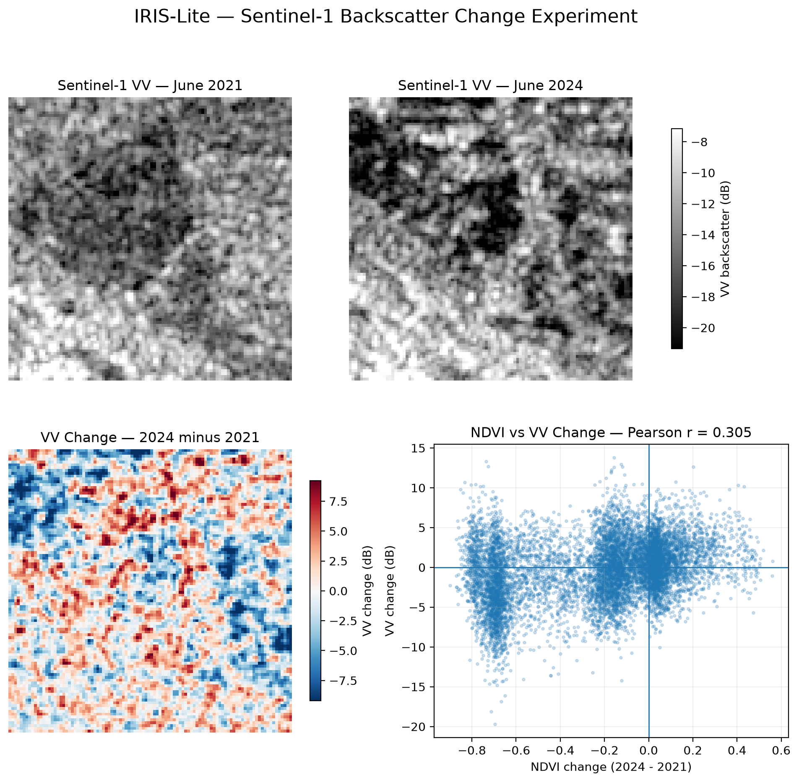

# IRIS-Lite — Earth Observation Infrastructure Resilience Monitor

IRIS-Lite is a portfolio-scale Earth Observation project for detecting and summarizing environmental and surface change around infrastructure assets using Sentinel satellite data.

The project demonstrates an end-to-end workflow combining satellite-data discovery, raster processing, change detection, geospatial output generation, and spatial database integration.

The implementation uses:

- Sentinel-2 multispectral imagery for vegetation-change analysis using NDVI
- Sentinel-1 SAR imagery for complementary radar backscatter-change analysis
- Copernicus Data Space Ecosystem for satellite-data discovery and processing
- Rasterio and NumPy for geospatial raster processing
- Cloud Optimized GeoTIFFs (COGs) for detailed raster outputs
- PostgreSQL/PostGIS for asset geometry, raster metadata, and change summaries
- Docker for a reproducible local PostGIS environment
- pytest for automated validation of core processing functions

The demonstration uses a 1 km x 1 km analysis area near Energiepark Witznitz in Saxony, Germany and compares approximately season-matched observations from 2021 and 2024.

## Key Results

### Sentinel-2 NDVI Change

Sentinel-2 Level-2A imagery from June 2021 and June 2024 was compared on an aligned 10 m analysis grid containing 10,000 pixels.

Results:

- 2021 mean NDVI: **0.542**
- 2024 mean NDVI: **0.306**
- Mean NDVI change: **-0.236**
- Median NDVI change: **-0.152**
- Pixels with decreased NDVI: **69.5%**

The analysis shows a substantial reduction in vegetation-like spectral response within the study area.

This is interpreted as an observed surface-change signal rather than proof that a particular development or event caused the change. Seasonal effects, land management, weather, data quality, and other environmental factors may also influence the measurements.

### Sentinel-1 Radar Backscatter Change

A complementary Sentinel-1 GRD experiment compared VV-polarized acquisitions from June 2021 and June 2024.

The selected acquisitions were matched by:

- Sentinel-1 platform
- acquisition mode
- product type
- orbit direction
- relative orbit
- polarization

The Sentinel-1 data were processed to sigma0 backscatter using the Copernicus Data Space openEO service and aligned to the same 10 m analysis grid used for Sentinel-2.

Results within the common 1 km x 1 km analysis area:

- 2021 median VV backscatter: **-14.01 dB**
- 2024 median VV backscatter: **-13.98 dB**
- Mean VV change: **-0.35 dB**
- Median VV change: **-0.17 dB**
- Pixels with decreased VV backscatter: **51.7%**
- Pearson correlation between NDVI change and VV change: **0.305**

The AOI-wide radar signal shows little net directional shift but substantial spatial variation. The weak-to-moderate spatial association with NDVI change demonstrates that radar provides complementary information rather than simply reproducing the optical vegetation signal.

This experiment measures radar backscatter change. It is **not an InSAR implementation**. Interferometric analysis would require phase-preserving SLC data and additional processing.



## System Architecture

The project separates satellite-data acquisition, raster processing, change analysis, raster storage, and spatial metadata persistence.

### Sentinel-2 workflow

1. Discover Sentinel-2 Level-2A products through the Copernicus Data Space STAC API.
2. Retrieve Red (B04), Near Infrared (B08), and Scene Classification Layer (SCL) assets.
3. Read the selected analysis area from the raster products.
4. Apply reflectance scale and offset metadata.
5. Align the categorical SCL raster with the analysis grid.
6. Apply SCL-based quality masking.
7. Calculate NDVI for each observation date.
8. Verify spatial alignment between the temporal observations.
9. Calculate pixel-level NDVI change.
10. Calculate summary change statistics.
11. Export the detailed change raster as a Cloud Optimized GeoTIFF.
12. Register the asset, raster footprint, temporal metadata, raster metadata, and summary statistics in PostGIS.

### Sentinel-1 workflow

1. Discover compatible Sentinel-1 GRD acquisitions using Copernicus metadata.
2. Match acquisition characteristics such as platform, mode, orbit geometry, and polarization.
3. Process VV data to sigma0 backscatter through the Copernicus Data Space openEO service.
4. Standardize the processed output to EPSG:32633 at 10 m resolution.
5. Verify alignment with the Sentinel-2 analysis grid.
6. Convert sigma0 values to decibels for comparison.
7. Calculate temporal VV backscatter change.
8. Compare the spatial radar-change pattern with the Sentinel-2 NDVI-change pattern.
9. Document the experiment and produce a comparison figure.

The Sentinel-2 workflow forms the main raster-to-PostGIS demonstration. Sentinel-1 is retained as a complementary experimental workflow and is not currently persisted to PostGIS.

## Design Decisions

### Raster files and PostGIS serve different purposes

Detailed pixel-level results remain in georeferenced raster files.

PostGIS stores information that is useful for querying and cataloging the analysis, including:

- monitored asset geometry
- analysis footprint
- observation dates
- index name
- summary change statistics
- valid-pixel counts
- raster CRS
- pixel size
- path to the raster product

This avoids treating the relational database as the primary storage location for detailed raster arrays while still making EO products spatially searchable.

### Spatial alignment is verified before change calculation

Two rasters cannot safely be subtracted simply because they use the same CRS and nominal pixel resolution.

Temporal comparison also requires compatible grid geometry so that corresponding array cells represent the same ground locations.

The workflow therefore verifies raster dimensions, transforms, CRS, and analysis extent before calculating change.

### Sentinel-2 quality masking uses SCL

The Scene Classification Layer is categorical data and is aligned using nearest-neighbor resampling.

Cloud, cloud-shadow, and cirrus classes are excluded from the NDVI calculation.

Resampling a lower-resolution categorical layer onto a 10 m grid does not create new spatial information; it only places the existing classifications onto the analysis grid.

### Sentinel-1 requires additional preprocessing

The Sentinel-1 GRD measurement data inspected during development exposed amplitude measurements that were not suitable for direct temporal subtraction.

The associated product metadata contained geolocation-grid and radiometric-calibration information.

Rather than manually recreating the SAR preprocessing chain, the project uses the Copernicus Data Space openEO backend to produce analysis-ready sigma0 backscatter for the experiment.

## Repository Structure

```text
iris-lite/
|
|-- docs/
|   |-- remote_sensing_primer.md
|   `-- sentinel1_findings.md
|
|-- notebooks/
|   |-- raster_forensics.ipynb
|   `-- sentinel1_experiment.ipynb
|
|-- outputs/
|   `-- sentinel1/
|       `-- sentinel1_change_2021_2024.png
|
|-- sql/
|   |-- schema.sql
|   |-- seed_data.sql
|   `-- analysis_queries.sql
|
|-- src/
|   |-- acquisition.py
|   |-- preprocess.py
|   |-- indices.py
|   |-- change_detection.py
|   |-- visualization.py
|   |-- export_cog.py
|   |-- postgis_loader.py
|   `-- pipeline.py
|
|-- tests/
|   |-- test_indices.py
|   `-- test_change_detection.py
|
|-- .env.example
|-- docker-compose.yml
|-- requirements.txt
`-- README.md
```

Large satellite source files and generated processing data are intentionally excluded from version control.

Private interview-preparation material is also excluded from the public repository.

## Setup

### 1. Clone the repository

```powershell
git clone <repository-url>
cd iris-lite
```

### 2. Create a Python virtual environment

```powershell
python -m venv .venv
.\.venv\Scripts\Activate.ps1
```

### 3. Install dependencies

```powershell
python -m pip install -r requirements.txt
```

### 4. Configure environment variables

Create a local environment file from the provided template:

```powershell
Copy-Item ".env.example" ".env"
```

Add your own Copernicus Data Space credentials to `.env`.

The default local database configuration is:

```text
POSTGRES_HOST=localhost
POSTGRES_PORT=5433
POSTGRES_DB=iris_lite
POSTGRES_USER=iris_user
```

Passwords and Copernicus credentials must remain in `.env` and must never be committed to version control.

### 5. Start PostGIS

The project uses Docker to provide a reproducible PostgreSQL/PostGIS environment.

```powershell
docker compose up -d
```

PostgreSQL runs on port `5432` inside the container and is exposed as `localhost:5433` on the host.

### 6. Initialize the database

```powershell
Get-Content "sql/schema.sql" | docker exec -i iris-lite-postgis psql -U iris_user -d iris_lite
Get-Content "sql/seed_data.sql" | docker exec -i iris-lite-postgis psql -U iris_user -d iris_lite
```

### 7. Run automated tests

```powershell
python -m pytest -v
```

## Code Organization

The project separates major processing responsibilities into small Python modules.

`src/acquisition.py` handles Sentinel-2 product discovery and acquisition-related functionality.

`src/preprocess.py` contains raster scaling, quality-mask, and raster-alignment operations.

`src/indices.py` contains spectral-index calculations such as NDVI.

`src/change_detection.py` contains temporal change calculations and summary statistics.

`src/visualization.py` contains result-visualization functionality.

`src/export_cog.py` handles georeferenced raster and Cloud Optimized GeoTIFF export.

`src/postgis_loader.py` handles persistence of EO change-product metadata to PostgreSQL/PostGIS.

`src/pipeline.py` combines the reusable Sentinel-2 raster-processing operations.

The modules are intentionally separated so individual stages can be inspected, tested, and replaced independently.

## Sentinel-2 Processing Function

The central reusable Sentinel-2 processing function is:

```python
from src.pipeline import process_sentinel2_window
```

`process_sentinel2_window()` accepts paths to Sentinel-2 Red, NIR, and SCL rasters together with an analysis window and reflectance-scaling metadata.

It returns:

- the calculated NDVI array
- raster CRS
- analysis-grid affine transform
- valid-pixel count
- total-pixel count
- valid-pixel fraction
- SCL classes present in the analysis area

The current repository demonstrates the processing stages as reusable modules and notebooks rather than presenting `pipeline.py` as a command-line application.

## Sentinel-1 Experiment

The radar experiment is documented in:

```text
notebooks/sentinel1_experiment.ipynb
docs/sentinel1_findings.md
```

The experiment demonstrates:

- Sentinel-1 GRD product inspection
- acquisition compatibility checks
- VV polarization selection
- server-side SAR backscatter processing with openEO
- spatial standardization
- cross-sensor grid verification
- temporal VV change calculation
- comparison of radar and NDVI change patterns

## PostGIS Integration

The spatial database schema is defined in:

```text
sql/schema.sql
```

Example database content is provided by:

```text
sql/seed_data.sql
```

Example spatial and analytical queries are provided in:

```text
sql/analysis_queries.sql
```

The database separates monitored infrastructure assets from derived EO change products and links them through an asset identifier.

Spatial GiST indexes support geometry-based queries.

## Testing

Automated tests currently cover core NDVI and change-detection behavior.

Run the test suite with:

```powershell
python -m pytest -v
```

The test suite is intentionally focused on deterministic processing functions rather than external Copernicus services.

## Limitations

This is a portfolio-scale demonstration rather than an operational infrastructure-monitoring platform.

Important limitations include:

- analysis of one demonstration area
- comparison of a limited number of observation dates
- NDVI change does not establish causation
- Sentinel-1 backscatter is affected by moisture, vegetation structure, surface roughness, viewing geometry, and other environmental factors
- the Sentinel-1 component is a backscatter experiment rather than InSAR
- scene-level cloud metadata does not replace AOI-level quality masking
- the demonstration asset geometry is not intended to represent an authoritative infrastructure boundary
- operational deployment would require stronger orchestration, monitoring, provenance tracking, error handling, and automated multi-date processing

## Future Work

Potential extensions include:

- automated multi-date time-series analysis
- additional Sentinel-2 indices such as NDWI
- multi-polarization Sentinel-1 analysis using VV and VH
- stronger radar normalization and terrain-aware processing
- automated STAC-to-analysis orchestration
- PostGIS catalog queries for multiple infrastructure assets
- web-map visualization of detected change
- automated quality-control reporting
- investigation of Sentinel-1 SLC and InSAR workflows where phase-based deformation analysis is appropriate

## Purpose

IRIS-Lite was developed as a focused engineering project to demonstrate how an existing Python and data-science skill set can be applied to Earth Observation workflows.

The emphasis is on reproducible processing, explicit spatial validation, conservative interpretation of satellite-derived signals, and clear separation between experimental analysis and production-ready capabilities.